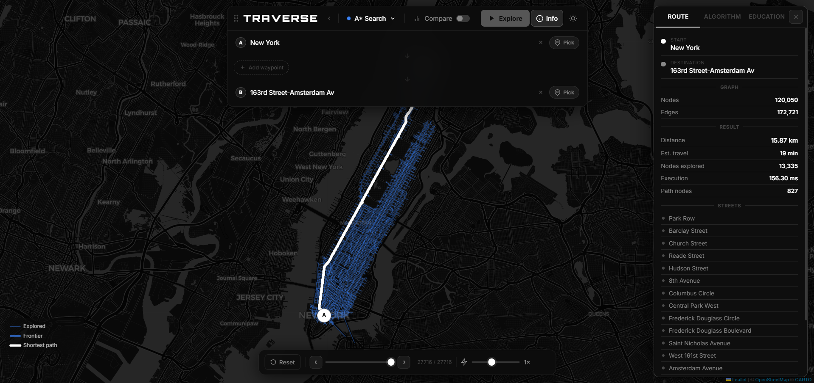

# TRAVERSE

[](./LICENSE)
[](https://www.typescriptlang.org/)
[](https://react.dev/)

**Traverse** is an interactive real-world pathfinding visualizer. Pick any two points on a live OpenStreetMap, choose an algorithm, and watch it explore the actual road network in real time.



---

## Features

- **6 algorithms** — Dijkstra, A\*, BFS, Greedy Best-First, Bidirectional Dijkstra, Bidirectional A\*
- **Compare mode** — run Dijkstra, A\*, and BFS side-by-side with live stats
- **Real road data** — fetched from OpenStreetMap via the Overpass API
- **Geocoding** — search for any location by name (Nominatim)
- **Playback controls** — play, pause, stop, reset, and 6 speed levels (including instant)
- **Light / dark mode**
- **Drag-and-drop** A/B pins directly on the map

---

## Quick start

### Prerequisites

- Node.js 18+
- npm 9+

### Install

```bash
npm install
```

### Run (development)

```bash
npm run dev
```

Open **http://localhost:5173**

> In development, Vite mounts the Express backend as middleware — a single process, single port. No separate server command needed.

### Production build

```bash
npm run build   # type-check + Vite bundle → dist/
npm start       # serves dist/ + API on port 3000
```

---

## Usage

1. **Search** or click the map to set a start point (A).
2. **Search** or click again to set an end point (B).
3. **Choose an algorithm** from the dropdown.
4. Click **Visualize** — Traverse fetches the road network and starts the animation.
5. Use **Pause / Resume / Stop / Reset** and the speed controls to explore at your own pace.
6. Switch to **Compare mode** to run Dijkstra, A\*, and BFS simultaneously and compare node counts, path lengths, and execution times.

---

## Algorithms

| Algorithm | Shortest path | Uses weights | Heuristic |
|---|---|---|---|
| Dijkstra | ✓ | ✓ | — |
| A\* | ✓ | ✓ | Haversine to goal |
| BFS | ✗ (fewest hops) | ✗ | — |
| Greedy Best-First | ✗ | ✗ | Haversine to goal |
| Bidirectional Dijkstra | ✓ | ✓ | — |
| Bidirectional A\* | ✓ | ✓ | Haversine (both ends) |

---

## Architecture

```
traverse/
├── src/
│   ├── algorithms/          # All 6 algorithm implementations (client-side)
│   ├── components/
│   │   ├── Map/MapView.tsx  # Leaflet map + canvas visualization engine
│   │   └── UI/              # TopBar, Sidebar, InfoPanel, controls
│   ├── context/
│   │   └── AppContext.tsx   # Global state (useReducer)
│   ├── lib/
│   │   ├── algorithmMeta.ts # Metadata, descriptions, pseudocode for all algos
│   │   └── graphUtils.ts    # Bounding box, nearest-node, haversine
│   ├── server/              # Express backend (co-located, mounted by Vite in dev)
│   │   ├── controllers/     # graphController, geocodingController
│   │   ├── middleware/      # errorHandler
│   │   └── services/        # overpassService, graphBuilder
│   ├── types/index.ts       # Shared TypeScript types
│   ├── server.ts            # Express app factory
│   └── start.ts             # Production entry point
├── vite.config.ts           # Mounts Express inside Vite dev server
├── tsconfig.server.json     # Server-only TypeScript config
└── package.json
```

### How it works

1. **Map click / search** — sets A and B markers on the Leaflet map.
2. **Visualize** — frontend requests the road graph for the bounding box from `/api/graph`.
3. **Backend** — queries the [Overpass API](https://overpass-api.de/) for OSM road ways, builds a weighted adjacency graph (edge weights = haversine distance in metres).
4. **Algorithm** — runs synchronously on the client, producing a `VisualizationStep[]` array.
5. **Animation** — a `requestAnimationFrame` loop steps through frames at the chosen speed, drawing coloured polylines on a `<canvas>` overlay above the Leaflet map.

---

## Tech stack

| Layer | Technology |
|---|---|
| Frontend | React 18, TypeScript, Vite |
| Map | Leaflet.js, OpenStreetMap / CARTO tiles |
| Canvas | HTML5 Canvas (direct 2D drawing, no library) |
| Backend | Node.js, Express, TypeScript |
| Road data | Overpass API (OpenStreetMap) |
| Geocoding | Nominatim (OpenStreetMap) |
| State | React `useReducer` |
| Styling | Pure CSS custom properties (no framework) |

---

## License

[MIT](./LICENSE) © Ujaan Mukherjee
